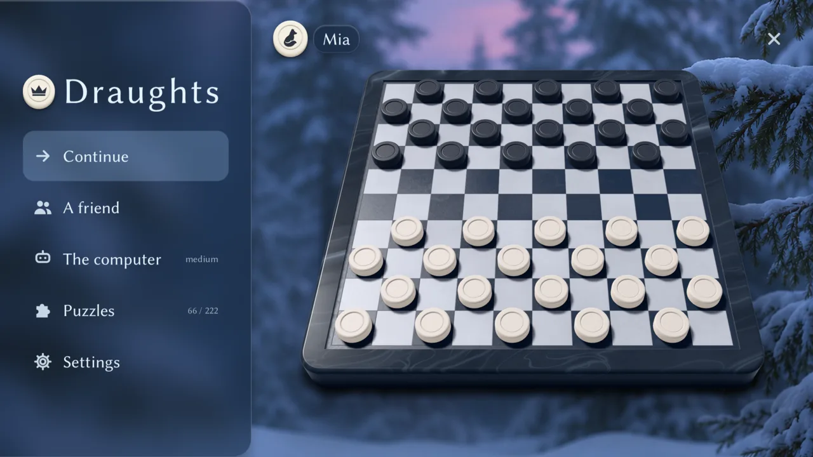
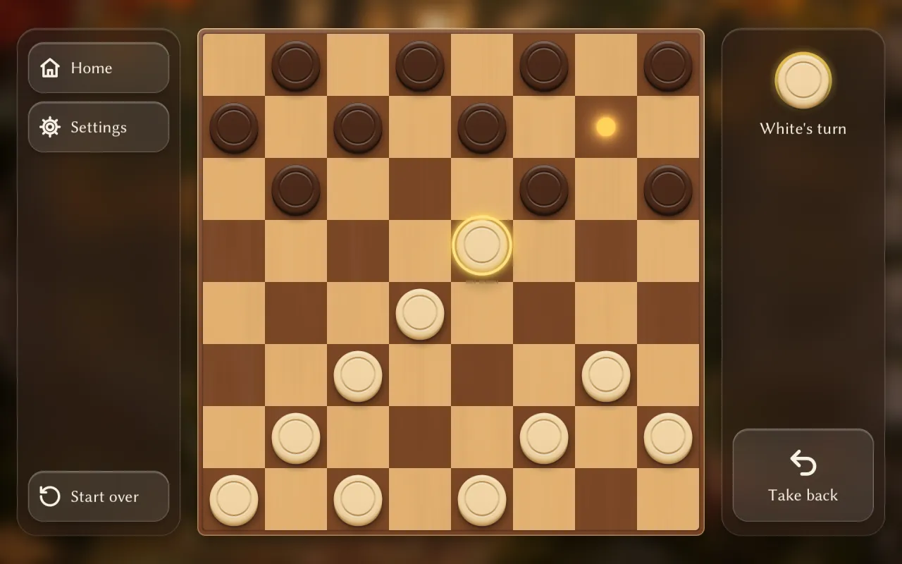

# Draughts

A calm draughts game for tablets and phones, on a flat 2D or a 3D board. Play the
computer or a friend, or solve puzzles. No ads, no accounts, no tracking, and no network.

<p align="center">
  
  
</p>

## Features

- A flat 2D board, or a 3D one with light and shadow, its camera turned by hand on home
- International draughts on the 10 × 10 board, and Brazilian and Russian on 8 × 8
- Play the computer at three levels, or a friend on the same device; with no clock, or
  5 or 10 minutes each
- 166 puzzles in themes, from the rules in action to multi-piece shots, with stars
- Up to four players on one device, each with an animal badge, their own look, hints,
  stars, and saved game
- Move hints that wait until a move is wrong, then show the square and why
- Four seasonal looks, each a photograph with its own board: autumn wood, winter stone,
  spring carved stone, and summer sunset
- No ads and no in-app purchases; nothing leaves the device
- English and Estonian

## Tested on

Every phone and tablet below is arm64. The app needs Android 10 (API 29) or later with
Vulkan, or iOS 16 or later with Metal.

| Device | Chip (CPU) | GPU, API | System | Status |
| --- | --- | --- | --- | --- |
| Galaxy Tab A11+ (SM-X230) | MediaTek MT6878 | Mali-G615 MC2, Vulkan 1.3 | Android 16 | Plays in 2D and 3D; the main test device |
| Pixel 7a | Google Tensor G2 | Mali-G710 MC7, Vulkan | Android 17 | Plays in 2D and 3D |
| Galaxy A33 5G (SM-A336B) | Samsung Exynos 1280 | Mali-G68 MP4, Vulkan 1.3 | Android 16 | Plays in 2D at 90 Hz and 3D at 75 on average while it moves, at 2× MSAA; the weakest tried |
| iPhone 13 mini | Apple A15 Bionic | Apple GPU, Metal | iOS 26 | Runs, a development build |
| iPad Pro 11-inch (M5), in the Simulator | The Mac's M1 Pro | Apple GPU, Metal | iPadOS 26.4 | Runs full screen and in resized windows, both orientations; the smallest windows still to fit |
| Mac with Apple silicon (M1 Pro) | Apple M1 Pro | Apple GPU, Metal | macOS | Runs in 2D and 3D; development and headless tests |
| Windows PC | AMD Ryzen 7 5800X3D | NVIDIA GeForce RTX 4090, Vulkan | Windows 11 | Runs in 2D and 3D; development, headless tests, and Android builds |
| Linux PC | AMD Ryzen 5 9600X | AMD Radeon RX 6800, Vulkan (RADV) | Bazzite 44, GNOME 50 | Runs in 2D and 3D, on Wayland and through XWayland |

## Implementation

### Performance

Release builds in a game, frames as they reached the screen:

| Device | Display | 3D board | Memory (2D / 3D) |
| --- | --- | --- | --- |
| Galaxy Tab A11+ | 1920 × 1200, 90 Hz | locked 90 fps | 137 / 295 MB |
| Pixel 7a | 2400 × 1080, 60 Hz | locked 60 fps | 159 / 324 MB |
| Galaxy A33 5G | 2400 × 1080, 90 Hz | 75 fps (45 fps 1% low) | 116 / 275 MB |
| iPhone 13 mini | 2340 × 1080, 60 Hz | locked 60 fps | 59 / 204 MB |
| Windows PC | 2560 × 1440, 165 Hz | locked 165 fps (uncapped 1,980) | 258 / 477 MB |
| Linux PC, Wayland | 1920 × 1080, 60 Hz | locked 60 fps (uncapped 3,600) | 84 / 89 MB, not counting VRAM |

- **2D board:** locked to the display's rate on every device.
- **Uncapped:** in brackets, the 3D board's average frames a second with the display's
  sync off (`--no-vsync`), on the desktops.
- **At rest:** under 0.35% of one core, no GPU work.
- **Memory:** the 3D board's extra is on the GPU.

[Full numbers and method](docs/architecture/rendering.md#the-releases-frames).

### How it works

- **Goose compiled to C**, on [goose_gfx](https://github.com/aardappel/goose_gfx) and
  SDL3's GPU API: Vulkan on Android, Windows, and Linux, Metal on Apple. No engine, no Gradle, no
  Xcode project; one Python script per platform.
- **Draws only on change.** A touch, a moving piece, or a clock's tick draws a frame;
  otherwise the app sleeps in the system's event wait
  ([frames and battery](docs/architecture/rendering.md#frames-and-battery)).
- **Immediate-mode UI.** Screens are declared in code each frame, no widget tree. Every
  panel, icon, and glyph is a quad in one fixed array, drawn in one instanced call
  ([UI layer](docs/architecture/rendering.md#ui-layer)).
- **One layout code for every screen size.** Rows and grids are cut from the screen in
  dp, fitted to the safe area, and compacted in small windows; checked headless at each
  device's size ([screen sizes](docs/architecture/rendering.md#screen-sizes-and-the-safe-area)).
- **Shapes in shaders.** The flat board is one full-screen pass; pieces, rings, and glass
  are signed distance shapes, crisp at any size. Text is a Libertinus Sans atlas baked at
  the screen's pixel size.
- **No allocation in the frame loop:** fixed arrays reset each frame.
- **Rules as pure functions** over bitboards, checked against published perft counts.
  Rules, computer, puzzles, and UI are tested headless.
- **The computer thinks on its own thread:** an alpha-beta search that counts nodes, not
  time, so a position gives the same move on every machine. Each level sees a fixed
  number of plies and picks among the good moves it sees, as a person of that level would.

The whole app in plain words, from launch to one tap followed to the computer's reply:
[Draughts from above](https://kaitk.github.io/draughts/architecture/). More in
[docs/architecture/](docs/architecture/README.md): [rendering](docs/architecture/rendering.md),
[rules](docs/architecture/rules.md), [computer player](docs/architecture/ai.md),
[puzzles](docs/architecture/puzzles.md).

## Where the program starts

Draughts is two Goose programs over one app, both in `src/main/`:

- `src/main/draughts_ngfx.goose` holds goose-ngfx (NoGraphicsAPI) too and picks a
  renderer when it starts (`--renderer auto|gfx|ngfx`). This is the build that ships on
  macOS, iOS, and Windows.
- `src/main/draughts.goose` draws through goose_gfx alone. This is the build that ships
  on Android and Linux, and the iOS Simulator runs it.

Each root holds only `main`, which calls `run`, the main loop in `src/app/app.goose`.
Its `.build` sidecar lists the program's C, which is in `src/native/`.

## Building and running

Every build script builds the app as it ships on its platform when given no program,
`--gfx-only` builds `src/main/draughts.goose` in its place, and each writes into `build/`. The scripts need the submodule and the pinned Goose
release in `build/`; [development](docs/development.md#toolchain) sets these up. On a Mac with Apple
silicon:

```sh
scripts/mac.py                  # build/draughts_ngfx
build/draughts_ngfx --board 3d
```

| Platform | Build from | Command | More |
| --- | --- | --- | --- |
| macOS | Mac | `scripts/mac.py` | [Run on the Mac](docs/development.md#run-on-the-mac) |
| Windows | Windows | `python scripts/windows.py --run` | [Run on Windows](docs/development.md#run-on-windows) |
| Linux | Linux | `scripts/linux.py --run` | [Run on Linux](docs/development.md#run-on-linux) |
| Android | Mac, Windows | `scripts/android.py --run`: build, install over USB, start | [Run on Android](docs/development.md#run-on-android) |
| iOS | Mac with Xcode | `scripts/ios.py --run` in the Simulator, `--device --run` on an iPhone | [Run on iOS](docs/development.md#run-on-ios) |
| goose-ngfx's part | Mac, Windows, Linux | a goose-ngfx checkout (`NGFX`) and slangc (`NGFX_SLANGC`) for the builds holding both renderers; `scripts/linux.py src/main/draughts_ngfx.goose` builds it on Linux | [Two renderers](docs/architecture/rendering.md#two-renderers) |

`--release` makes the store and download builds; [development](docs/development.md) has
them, the development flags, and how to measure a device.

The tests run headless:

```sh
python3 test/run_tests.py
scripts/test.sh                 # also the app's shaders, perft, and a random-game check
```

The season photographs the app embeds are in `design/backgrounds/masters/`; their
originals stay local (`design/backgrounds/README.md`).

## Layout

[Where things live](https://kaitk.github.io/draughts/architecture/#where-things-live)
says what each folder is for, in plain words.

```text
src/            the program's Goose and C
  main/           the two programs' roots and their .build sidecars
  app/            the main loop, the drawers, the window, the flags, and the bench
  gfx/            the goose_gfx renderer
  ngfx/           the goose-ngfx renderer and its shaders
  native/         the program's C: storage, locales, the safe area, the photographs
  rules/          the rules of each variant, pure functions with no graphics
  ai/             the computer player
  puzzles/        the puzzles and their checks
  board/          the board's logic, layout, and draw lists
  game/           the game screen and its clock
  shell/          home, settings, puzzles, players, and which screen shows
  gui/            the UI layer: layout, glass, buttons, text
  model3d/        the 3D board's meshes and looks, with no graphics
  render3d/       the 3D board's renderer
  sound/          the sounds
  badges/         the players' animal badges
strings/        the text, one file per language
assets/         the fonts, the badges, and the sounds
platform/       each platform's files: Android's activity and resources, iOS's project,
                the desktop icons, the Windows installer
scripts/        the builds, one per platform, and the test run
tools/          perft, the computer's benchmarks, a terminal player, the puzzle checker
  perf/           device and frame measurements
  assets/         the scripts that make the board pictures, badges, and sounds
test/           headless tests with their expected output
patches/        patches to SDL, applied to a copy at build time
third_party/    goose_gfx, as a submodule, with SDL and Nuklear; SMAA
store/          the Play and App Store listings, their previews, and the privacy policy
design/         the icon's, backgrounds', and tabletops' sources and how they were made
prototypes/     HTML prototypes of the UI, checked before building in Goose
docs/           product scope, architecture, decisions, development
tasks/          the work, one file per task
```

## Documentation

- [Product](docs/product.md): what the app is for, the MVP, and what follows
- [Draughts from above](https://kaitk.github.io/draughts/architecture/): the app's start-up, loop, packages,
  and threads, in plain words
- [Architecture](docs/architecture/README.md): how the app works
- [Decisions](docs/decisions/README.md): each design decision, dated, with its reason and
  what it rejected
- [Development](docs/development.md): the toolchain, building, running, and testing
- [Goose findings](docs/goose-findings.md): gaps found in Goose and goose_gfx, and the
  patches for them
- [Store](store/README.md): the Play and App Store listings and the privacy policy
- [Tasks](tasks/README.md): the work, one file per task

## License

Licensed under either of the [Apache License, Version 2.0](LICENSE-APACHE) or the
[MIT license](LICENSE-MIT), at your option. Unless you state otherwise, any
contribution you submit for inclusion, as defined in the Apache-2.0 license, is
licensed the same way, without any additional terms or conditions.

Third-party parts keep their own licenses:

- [Goose](https://github.com/aardappel/goose), the language and runtime, and
  [goose_gfx](https://github.com/aardappel/goose_gfx): Apache 2.0.
- [SDL](https://github.com/libsdl-org/SDL) and Nuklear, through goose_gfx: zlib, and
  public domain or MIT. Nuklear's copy of `stb_image.h` (public domain or MIT) decodes
  the photographs on the Mac.
- The fonts in `assets/fonts/`, [Libertinus Sans](https://github.com/alerque/libertinus)
  and [Tenor Sans](https://fonts.google.com/specimen/Tenor+Sans): SIL Open Font License
  1.1, with the license beside each font.
