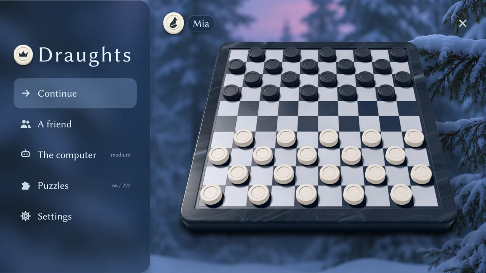
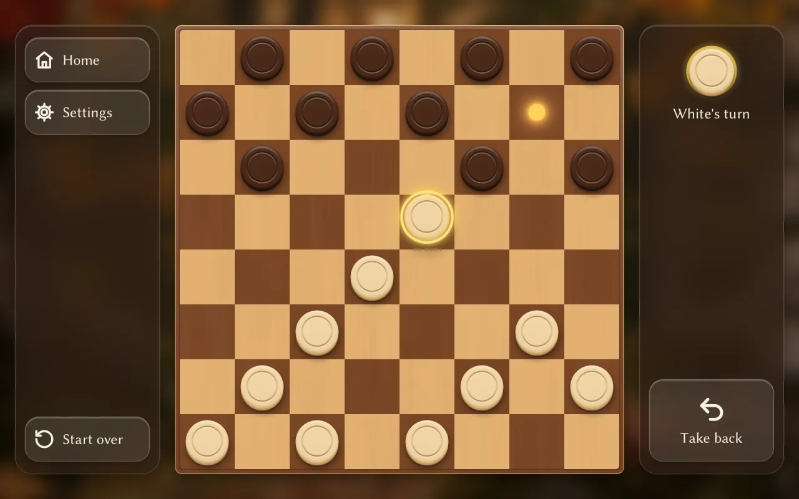

# Draughts

A calm draughts game for Android tablets and phones. Play a friend or the computer, or
solve puzzles. No ads, no accounts, no tracking, and no network.

<p align="center">
  
  
</p>

## Features

- International draughts on the 10 × 10 board, and Brazilian and Russian on 8 × 8
- Play a friend on the same device, or the computer at three levels
- Puzzles, from the first capture to multi-piece shots
- Four seasonal looks, each a photograph with its own board: autumn wood, winter stone,
  spring carved stone, and summer sunset
- A flat board or a 3D one, lit and shadowed, its camera turned by hand on home
- Works offline, with no ads and no in-app purchases
- English and Estonian

## Tested on

Every device below is arm64. The app needs Android 10 (API 29) or later with Vulkan, or
iOS 16 or later with Metal.

| Device | Chip (CPU) | GPU, API | System | Status |
| --- | --- | --- | --- | --- |
| Galaxy Tab A11+ (SM-X230) | MediaTek MT6878 | Mali-G615 MC2, Vulkan 1.3 | Android 16 | Plays in 2D and 3D; the main test device |
| Pixel 7a | Google Tensor G2 | Mali-G710 MC7, Vulkan | Android 17 | Plays in 2D and 3D |
| Galaxy A33 5G (SM-A336B) | Samsung Exynos 1280 | Mali-G68 MP4, Vulkan 1.3 | Android 16 | Plays in 2D at 90 Hz and 3D at about 39 fps while it moves; the weakest tried |
| iPhone 13 mini | Apple A15 Bionic | Apple GPU, Metal | iOS 26 | Runs, a development build (task 043) |
| Mac with Apple silicon (M1 Pro) | Apple M1 Pro | Apple GPU, Metal | macOS | Development and headless tests |

Measured numbers per device are in [task 015](tasks/015-3d-board.md) and
[task 042](tasks/042-3d-frame-cost.md); [development](docs/development.md) has the
details.

## Implementation

### Performance

**Galaxy Tab A11+** (1920 × 1200, release build, 2026-11-09):

- Idle at home: 0.05% of one CPU core
- Memory at home: 134 MB (PSS)
- Of that, 58 MB is the GPU driver's swapchain (six screen-sized images, its minimum)
  and 36 MB the app's own GPU memory

**Pixel 7a** (1080 × 2400, development build, 2026-11-08):

- Idle at home: 0.1% of one CPU core
- Memory: 146 MB at home, 161 MB in a game (PSS)
- Graphics memory: 116 MB

The app draws a frame only when something changes (a touch, a moving piece, a clock's
change). Otherwise it draws nothing and waits for input, waking about once a second on
Android, so an idle board costs next to no CPU and no GPU work.

### How it is built

- **Goose, compiled to C,** with [goose_gfx](https://github.com/aardappel/goose_gfx) on
  SDL3's GPU API: Vulkan on Android, Metal on the Mac and iOS. No engine, no Gradle, no
  Xcode project.
- **Shaders draw everything:** the board in one full-screen pass, the pieces, rings, and
  glass panels as signed distance shapes, crisp at any size. All pieces are one
  instanced draw, the whole UI another.
- **Text from a glyph atlas** of Libertinus Sans, baked once at the screen's pixel size so
  a glyph is drawn a texel to a pixel; each glyph is one more quad in the UI's draw.
- **No allocation in the frame loop:** fixed arrays reset each frame, tables sized at
  startup.
- **Rules as pure functions** over bitboards, checked against published perft counts;
  rules, the computer, puzzles, and the UI are tested headless.
- **A computer that plays like a person** of its level, on its own thread, not an engine
  with noise added.

The details and their reasons are in [docs/architecture/](docs/architecture/README.md):
[rendering](docs/architecture/rendering.md), the [rules](docs/architecture/rules.md),
the [computer player](docs/architecture/ai.md), and the
[puzzles](docs/architecture/puzzles.md).

## Building and running

On a Mac with Apple silicon, from a clone with its submodule and the pinned Goose release
in `build/` ([docs/development.md](docs/development.md#toolchain) sets these up):

```sh
cd src/app
../../build/goose-v2026.4-macos-arm64/goose build -o ../../build/draughts draughts.goose
../../build/draughts
```

On an Android device with USB debugging on, with the Android SDK, NDK r29, and a JDK:

```sh
scripts/android.py src/app/draughts.goose --run     # build the APK, install it, start it
```

For iOS, with Xcode (the Simulator, or an iPhone with a signing identity):

```sh
scripts/ios.py src/app/draughts.goose --run             # the Simulator
scripts/ios.py src/app/draughts.goose --device --run    # an iPhone
```

The tests run headless:

```sh
python3 test/run_tests.py
scripts/test.sh                 # also perft and a random-game check of the rules
```

The season photographs are not in the repository (`design/backgrounds/README.md` says how
they were made); a build without them shows the board on the season's plain color.
[docs/development.md](docs/development.md) has the rest: the toolchain, development
flags, the Android and release builds, and how to measure idle CPU and memory.

## Layout

```text
src/          the program: one directory per package, and the app
  rules/        the rules of each variant, pure functions with no graphics
  ai/           the computer player
  puzzles/      the puzzles and their checks
  board/        the board's logic and draw lists
  render3d/     the 3D board's renderer: meshes, shaders, and its looks
  gui/          the UI layer: layout, glass, buttons, text
  game/         the game screen and its clock
  shell/        home, settings, puzzles, players, and which screen shows
  badges/       the players' animal badges
  app/          the main loop, the GPU drawing, and the platform's C
strings/      the text, one file per language
assets/       the fonts and the badges
android/      the manifest, the activity, resources, and the native build
ios/          the iOS entry point and its native build
scripts/      the Android and iOS builds, the icon, and device measurements
tools/        perft, computer-player benchmarks, a terminal player, the puzzle checker
test/         headless tests with expected output
patches/      patches to goose_gfx and SDL, applied to a copy at build time
third_party/  goose_gfx, as a submodule, with SDL and Nuklear
store/        the Play and App Store listings, their previews, and the privacy policy
docs/         product scope, architecture decisions, development
```

## Documentation

- [Product](docs/product.md): what the app is for, the MVP, and what follows
- [Architecture](docs/architecture/README.md): the decisions and their reasons
- [Development](docs/development.md): the toolchain, building, running, and testing
- [Goose findings](docs/goose-findings.md): gaps found in Goose and goose_gfx, and the
  patches for them
- [Tasks](tasks/README.md): the work, one file per task

## License

Licensed under either of the [Apache License, Version 2.0](LICENSE-APACHE) or the
[MIT license](LICENSE-MIT), at your option. Unless you state otherwise, any
contribution you submit for inclusion, as defined in the Apache-2.0 license, is
licensed the same way, without any additional terms or conditions.

Third-party parts keep their own licenses:

- [Goose](https://github.com/aardappel/goose), the language and runtime, and
  [goose_gfx](https://github.com/aardappel/goose_gfx): Apache 2.0.
- [SDL](https://github.com/libsdl-org/SDL) and Nuklear, through goose_gfx: zlib, and
  public domain or MIT. Nuklear's copy of `stb_image.h` (public domain or MIT) decodes
  the photographs on the Mac.
- The fonts in `assets/fonts/`, [Libertinus Sans](https://github.com/alerque/libertinus)
  and [Tenor Sans](https://fonts.google.com/specimen/Tenor+Sans): SIL Open Font License
  1.1, with the license beside each font.
