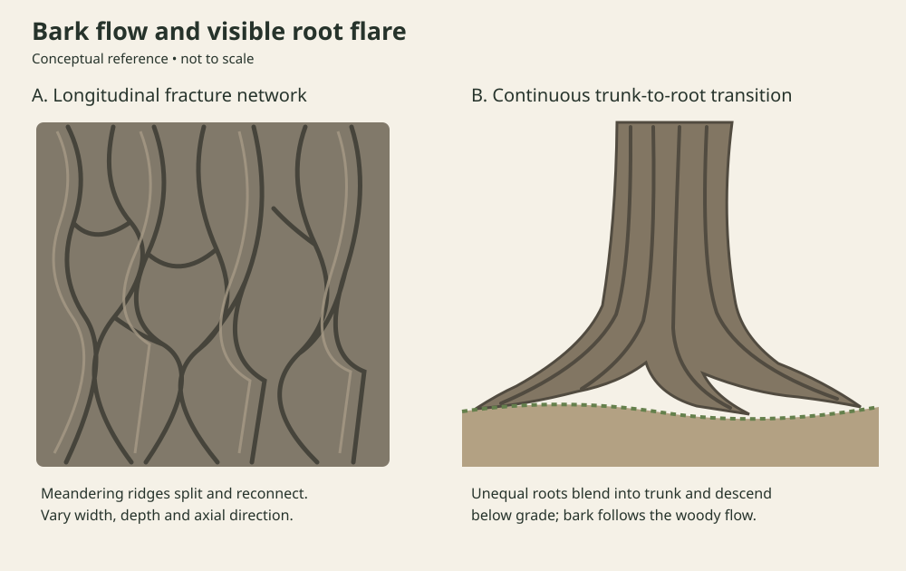

# Procedural trees: bark morphology and visible root architecture
Companion to the gravity-aware tree brief. Target: mature Norway maple (Acer platanoides) in an Estonian manor park, with reusable presets for other local species. Underground roots are explicitly out of scope. All numeric defaults below are artistic engineering starting points, not measured botanical constants.



## 1. Botanical target
Norway maple develops dark grey-brown bark with narrow elongated interconnected ridges and comparatively shallow furrows as it ages; young bark is smoother. Some mature trunks show elongated diamond-like intersections. See [1–3]. Do not confuse it with sycamore maple's often flaky mature bark, sugar maple, or the coarser fissures of old oak. Avoid uniform vertical stripes, identical diamond grids, and exaggerated black crevices. Bark on old trunk, major limbs, young branches and twigs must differ continuously. The shallow spreading root system makes surface roots plausible, but exposure depends on soil and site; a healthy park lawn is not an eroded roadside.

## 2. Geometry first
Preserve existing skeleton, seed, taper, gravity deformation and species branching. Build trunk and branch surfaces with slowly varying asymmetric cross-sections, subtle longitudinal lobing, eccentricity and localized swellings. Model branch collars, bark ridges at forks and healed scars only where plausible. Avoid spherical junction blobs or disconnected overlapping cylinders. Use blended implicit surfaces (local SDF union with controlled blend radius), or stitched junction meshes with smooth normals. Preserve branch silhouettes. Bark needs coherent directional flow around collars, forks and root flares rather than vertical world-space stripes.

## 3. Bark generation: three spatial scales
* Macro (roughly 5–50 cm): trunk lobes, broad longitudinal ridges, swelling around root and branch junctions, irregular scars; actual mesh where silhouette matters.
* Meso (roughly 5–50 mm): fracture network, ridge shoulders, narrow fissures, occasional short oblique connecting cracks; height/displacement plus normals. For an initial maple preset try ridge spacing 10–35 mm, relief 1–6 mm, and axial correlation length 3–10 times spacing. These are tuning ranges, not species measurements.
* Micro (sub-mm to several mm): granular cork, tiny flakes and fine cracks, mostly normal/roughness. Avoid white noise across every scale.

Recommended fast method: sample a seamless cylindrical or surface-flow coordinate field in physical metres. Generate jittered, elongated anisotropic cells or sparse branching crack curves, domain warp at several scales, and vary ridge width and crack depth. Break the regularity using locally varying orientation, occasional terminating cracks and merging ridges; don't merely stretch Voronoi uniformly. Build a signed distance to cracks; shape rounded ridge crowns, asymmetric shoulders and narrow recesses with a controllable profile. Blend with correlated coarse relief and fine texture. Use periodic circumferential sampling at seams. A more physical offline method uses secondary cambial expansion to introduce tensile stress and propagate fractures, as in [4,5].

Suggested pseudocode:
```
flow = transportedSurfaceFrame(skeleton, junctions)
maturity = smoothAgeAndRadiusField(segmentAge, radius)
uv = flowCoordinatesInMetres(surface, flow)
cracks = anisotropicCrackNetwork(warp(uv), seed, maturity, preset)
height = ridgeProfile(distanceTo(cracks), preset) + macroRelief + microRelief
height *= maturityDependentAmplitude
normal = surfaceGradientNormal(height, metric)
```
Age is preferred over diameter as a proxy; do not assume all thin old branches are young. Fade to smooth young bark rather than shrink the same trunk pattern to microscopic scales. At forks and root junctions, transport the tangent field or blend local charts using a continuous 3D field; check for doubled patterns, UV seams and stretched texels. Triplanar mapping alone is not sufficient for directional bark; orient it with local woody flow.

## 4. PBR material
Generate correlated base color, height, tangent-space normal, roughness and optional cavity mask. Bark is dielectric (metalness 0). Base color must not bake direct lighting, directional shadows or highlights. Darker fissures may reflect real material variation but avoid double-counting ambient occlusion. Start with broad grey-brown hue variation and roughness around 0.65–0.95, tune under neutral light. Generate normal from the same height field; use displacement only at close LOD, avoiding exaggerated relief. Moss and lichens are separate masks: low-frequency clustered growth influenced by moisture, shade, surface orientation and ground proximity, not uniform green noise or a mandatory north-facing rule. Keep moss relief/material distinct from bark; bark remains beneath. Do not introduce seasonal bark color swaps merely because leaves change.

## 5. Visible roots and trunk flare
Root flare (root collar region) is the widening transition at ground level into primary structural roots [6,7]. Buttress-like ridges may occur in temperate trees, but don't create tropical plank buttresses by default. Generate unequal structural root lobes, each blending smoothly upward into the trunk, tapering radially and descending into terrain. Roots should appear partially buried, not like separate round tentacles resting on grass. Some roots disappear immediately; others reappear where ground dips. Don't model underground networks except a short hidden continuation for seam-free intersection.

Algorithm:
1. Sample terrain height and normal around tree; establish trunk base at local grade, not an arbitrary flat plane.
2. Choose irregular azimuths and root strengths (initial mature-maple artistic preset 4–7 major lobes; not a botanical count). Avoid equal radial spacing and identical lengths; allow gaps.
3. Construct curved radial centerlines with gradual taper, a vertical profile descending relative to grade, and limited secondary forks. Start each inside trunk volume and end below terrain. Example exposed reach 0.3–1.5 trunk diameters for a lawn, longer only with appropriate erosion; vary independently. Flare height starting range 0.2–0.6 trunk diameters. Set trunk diameter at breast height as reference.
4. Sweep asymmetric elliptical sections with broad buried bases and rounded exposed ridges. Blend with trunk using local smooth union or watertight stitching. Keep valleys between root lobes and avoid bulbous junctions. Use local meshing only; no need for full-tree voxelization.
5. Compute visibility from terrain intersection, not arbitrary opacity. Keep buried portions hidden and avoid floating ends, exposed caps or z-fighting. Terrain contact and grass suppression can follow distance to exposed woody surface; blend litter, soil and moss without black outline decals.
6. Align bark flow with root direction, bending progressively from trunk axial flow into radial roots. Match scale and color at transition. Add contact shadows through renderer, not baked into albedo.

For terrain slopes, use sampled terrain rather than forcing roots horizontal. Soil erosion and compaction change exposure, not necessarily the underlying root shape. [8] is a more complete developmental root model; its below-ground simulation is unnecessary for this game.

## 6. Species presets (visual starting points; consult atlas [9])
| Species | Bark target | Base/root appearance |
|---|---|---|
| Norway maple (Acer platanoides) | narrow connected longitudinal ridges, shallow to moderate furrows, grey-brown | irregular broad flare, occasional shallow surface roots |
| Pedunculate oak (Quercus robur) | coarse, deep, irregular longitudinal fissures, blockier ridges on old trunks | robust uneven flare; exposure site-dependent |
| Silver birch (Betula pendula) | pale papery bark, horizontal lenticels, dark rough fissured lower trunk with age | comparatively restrained flare on many individuals; dark basal bark |
| Norway spruce (Picea abies) | small irregular grey-brown/reddish scales and plates | shallow spreading structural roots, often mossy; exposure variable |
| Scots pine (Pinus sylvestris) | coarse dark basal plates, orange-red flaky upper bark | variable flare and surface roots; do not infer visible root count from rooting habit |
| Small-leaved lime (Tilia cordata) | grey-brown longitudinal fissures with age; smoother young bark | broad irregular base; optional basal shoots only when desired |
| European aspen (Populus tremula) | smooth grey-green young bark with dark marks; older basal bark fissured | modest to irregular flare; site-dependent |

Expose per-species fracture mode (fissured, plated, exfoliating, smooth/lenticellate), axial anisotropy, scale, depth, ridge shape, color palette, age transition, base flare, root exposure propensity. Birch and pine need height-dependent material transitions; do not just recolor maple noise. Species root appearances are illustrative, not diagnostic rules.

## 7. Performance and validation
Bake deterministic meshes and material fields per seed. Reuse material atlases with physical-scale mapping and per-tree variation. Near LOD: true flare, collars and macro relief; meso displacement only as needed. Mid LOD: flare geometry plus normal map; far LOD: simplified silhouette and filtered material. Prevent normal aliasing with mipmaps and roughness adjustment. Preserve root contact and trunk silhouette through LOD transitions. Avoid per-frame fracture simulation.

Acceptance tests: fixed seed before/after; render isolated trunk at 0.5, 2 and 8 m, base from four directions and branch fork close-up; neutral overcast plus raking sunlight. Compare old trunk with young shoots. Inspect wireframe and height-only view, texture seam, forks and root transitions, flat and sloping ground, and three root exposure settings. Verify no floating roots, repetitive star shape, abrupt bark direction changes, baked lighting, obvious tile repetition or uniform bark across species. Produce a species comparison contact sheet and report generation time, triangle count, texture memory and LOD behavior. Do not claim biological calibration without measured references.

## 8. Research and photographic references
1. Caudullo & de Rigo (2016), European Atlas of Forest Tree Species, Norway maple. https://forest.jrc.ec.europa.eu/media/atlas/Acer_platanoides.pdf — p.55 has a mature bark photograph credited AnRo0002, CC0.
2. USDA Silvics, Norway maple: https://research.fs.usda.gov/silvics/norway-maple — intersecting bark ridges.
3. UConn Extension, Norway maple: https://extension.uconn.edu/publication/norway-maple/ — age-dependent bark and shallow spreading roots, photos.
4. Synthesizing Bark (2002): https://doi.org/10.2312/EGWR/EGWR02/105-116 — fracture-based bark synthesis, age and continuity; read first.
5. Kratt et al. (2015), Woodification: User-Controlled Cambial Growth Modeling: https://graphics.uni-konstanz.de/publikationen/Kratt2015WoodificationUserControlled/index.html — growth-coupled cracking and junctions; figures and paper.
6. Colorado State Extension, Understanding Tree Roots: https://extension.colostate.edu/resource/understanding-tree-roots/ — structural roots, root flare and surface roots.
7. UConn Extension Forestry, Plant a Tree: https://ctforestry.cahnr.uconn.edu/plant-a-tree/ — root flare photo and grade relationship.
8. Li et al. (2023), Rhizomorph: The Coordinated Function of Shoots and Roots: https://wp.faculty.wmi.amu.edu.pl/papers/Rhizomorph.html — developmental procedural roots, terrain/soil context.
9. European Atlas species chapters: https://forest.jrc.ec.europa.eu/en/european-atlas/atlas-download-page/ — verify each species individually.
10. Interactive Modeling of Tree Bark: https://www.microsoft.com/en-us/research/publication/interactive-modeling-of-tree-bark/ — image-driven height-field synthesis alternative.
11. NC State Extension photographic reference: https://plants.ces.ncsu.edu/plants/acer-platanoides/common-name/norway-maple/ — mature trunk close-up.
12. Halifax Tree Project: https://www.halifaxtreeproject.com/the-norway-maple — extreme urban exposed roots; do not use as a default lawn reference.
13. Woodland Trust identification guide: https://www.woodlandtrust.org.uk/trees-woods-and-wildlife/british-trees/how-to-identify-trees/ — age-related bark differences.

Photographs are linked rather than redistributed; verify individual licenses before using as game textures. The included SVG is an original conceptual illustration, not a measured scan. Research supports general morphology and methods; the proposed algorithms and numeric settings are implementation suggestions.
