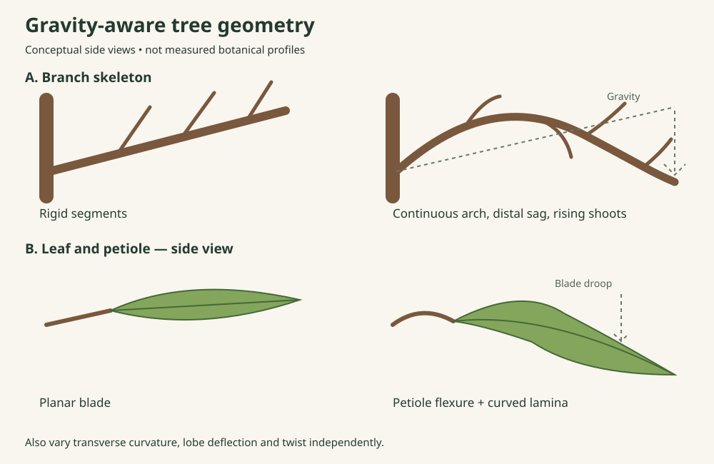

# Biomechanically informed procedural tree generation

## Objective — instructions to the implementation AI
Improve the existing tree generator so trees have convincing mass, elasticity and three-dimensional foliage even in still air. Target a mature Norway maple (Acer platanoides) in an Estonian manor park. Preserve existing species architecture, rendering pipeline and deterministic seeds where practical. Inspect the current code before choosing integration points. Do not merely rotate rigid leaves or add random downward branch angles.

## Visual reference plate

The plate is an original explanatory schematic, not measured botanical geometry. For real photographic references, inspect the [Norway maple image collection](https://commons.wikimedia.org/wiki/Category:Acer_platanoides), especially lateral branches and oblique views of leaves. Use photographs to calibrate rather than blindly copying the schematic.

## 1. Branch geometry
- Generate a continuous, progressively tapered skeleton with species-specific branching. Norway maple has opposite buds and branching, with natural omissions, unequal growth and asymmetry.
- Distinguish developmental curvature (growth direction, light seeking, gravitropic correction) from passive self-weight bending. A branch can rise initially, arch outward, sag distally and have upward-growing terminal shoots. Do not impose this exact shape on every branch.
- Compute branch loading from its own mass plus the mass and lever arms of descendant branches, petioles and foliage. Horizontal limbs generally experience greater bending moments than upright limbs of comparable dimensions.
- Keep junctions continuous and transport child attachment positions and frames with the parent deformation. Preserve segment lengths approximately and rebuild tube geometry and normals from the deformed skeleton. Avoid kinks and detached foliage.

### Suggested implementation
Use a post-order pass to accumulate subtree mass and center of mass. For a section at position p, the approximate gravitational torque from supported mass m at center c is `(c-p) × (m*g)`, with g in world space. Include distributed segment mass and project torque perpendicular to the local tangent for bending. For a circular section, `I = π r^4 / 4`, and the small-strain beam approximation gives curvature `κ = M/(E I)`. E is an effective stiffness, not necessarily a measured wood constant. Use consistent units. Integrate curvature along segments using local rotation frames, preserving arc length. Recompute loads after deformation if needed; use bounded iterations, damping and curvature limits to avoid unstable large rotations. Near-vertical branches should not receive arbitrary lateral bending from gravity alone.

For an inexpensive alternative, use the supported mass and projected lever arm to drive a smooth bounded curvature heuristic, with effective stiffness dependent on radius and species. Stava et al. [1] provide a directly relevant procedural precedent. Long-term growth adaptation matters [2,3]: do not treat an already mature reference skeleton as a fully unloaded beam and then apply its entire lifetime weight again. Treat the effect as residual sag if the baseline already contains growth curvature.

## 2. Leaf geometry
A leaf is a flexible, structured surface, not a rigid polygon. Separate:
- Petiole flexure: curved stalk supporting the blade; leaf base remains attached to its endpoint.
- Longitudinal lamina/midrib curvature: blade tip bends relative to its base.
- Transverse curvature and marginal curling: edges bend relative to the central vein.
- Independent lobe deflection: maple's major veins support distinct lobes, whose tips and margins can deform differently.
- Torsion: asymmetric twist along the blade, potentially combined with bending.

Use a tessellated leaf mesh or a small library of curved variants, preserving the silhouette, UV mapping and vein layout. Anchor the petiole and lamina base. Derive the direction of passive sag from world-space gravity projected into the appropriate local bending directions; do not blindly displace vertices along local negative Z. Distinguish passive gravity from intrinsic cupping, developmental shape and autumn drying. Leaf stiffness depends on tissue and hydration; not every leaf droops [4–6].

### Practical deformation
Parameterize the blade by distance along its main vein and distance from the nearest major vein. Use smooth weights that increase away from the base and supporting veins. Give lobe tips correlated but non-identical curvature. Prefer smooth rotations or arc-based bending over unconstrained vertical displacement, which can stretch the leaf. Recalculate normals/tangents; ensure the back face shades correctly. Use deterministic variation per leaf and correlated variation per shoot. Keep some leaves nearly planar; avoid uniform umbrella-like drooping, excessive crumpling or a sickly wilted appearance.

## 3. Parameters and performance
Suggested controls (artist-tunable, not measured botanical constants): branchGravityStrength, effectiveWoodStiffness, maxBranchCurvature, growthCorrection, petioleFlexure, bladeDroop, transverseCurl, lobeDeflection, leafTwist, leafStiffnessVariation. Separate static deformation from dynamic wind. Bake rest geometry at generation time; use instanced curved leaf templates or GPU deformation if appropriate. At distant LODs preserve the overall silhouette, foliage orientation and branch arches rather than detailed individual leaf curling.

## 4. Acceptance tests
- Render identical seeds with gravity disabled and enabled; compare side views and canopy silhouettes.
- Inspect a single lateral branch with all foliage attached and an unobstructed close view of multiple leaves from above and the side.
- Verify that heavier horizontal subtrees sag more than comparable lighter ones and that increasing radius reduces bending, all else equal.
- Verify that vertical limbs do not bend sideways simply because gravity is enabled; rotated test branches respond to world-space gravity.
- Check that no petioles detach, no branch intersections are introduced unnecessarily, and UVs/normals remain valid.
- Inspect several seeds and seasons: healthy maple leaves should vary naturally, rather than uniformly droop. Confirm that the static result looks convincing before adding wind.
- Document what was changed, the assumptions and the performance cost; provide before/after renders.

## Research and implementation references
1. Stava et al. (2014), *Inverse Procedural Modelling of Trees*, Computer Graphics Forum. [DOI](https://doi.org/10.1111/cgf.12282) · [Project page with figures and paper](https://graphics.uni-konstanz.de/publikationen/Stava2014InverseProceduralModelling/index.html). Directly relevant to procedural gravity bending based on supported mass and branch direction.
2. Alméras & Fournier (2009), *Biomechanical design and long-term stability of trees*. [PubMed](https://pubmed.ncbi.nlm.nih.gov/19013473/). Balance between increasing self-weight and gravitropic correction.
3. *Gravitropisms and reaction woods of forest trees – evolution, functions and mechanisms*. [DOI](https://doi.org/10.1111/nph.13968). Explains corrective growth and branch posture.
4. *A trade-off between transport and mechanics determines plant leaf vein architecture*. [Article and figures](https://www.nature.com/articles/s44383-025-00007-3). Mechanical support by veins and leaf self-weight.
5. *Charting the twist-to-bend ratio of plant axes*. [Open access article and figures](https://pmc.ncbi.nlm.nih.gov/articles/PMC9214286/). Petiole bending and twisting mechanics.
6. *Twist-to-Bend Ratios and Safety Factors of Petioles Having Various Geometries, Sizes and Shapes*. [Open access](https://pmc.ncbi.nlm.nih.gov/articles/PMC8632552/). Petiole self-support and flexibility.
7. Helios Plant Architecture Model. [Implementation documentation](https://plantsimulationlab.github.io/Helios/_plant_architecture_doc.html). Practical reference for separating blade droop from petiole geometry.

The proposed mesh deformation and parameter names are engineering recommendations, not formulas directly validated for Norway maple by these papers. No species-specific stiffness constants are assumed.
